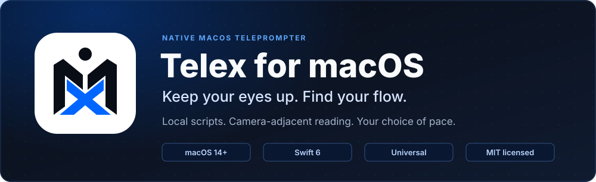
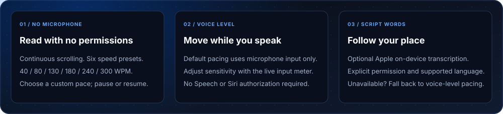
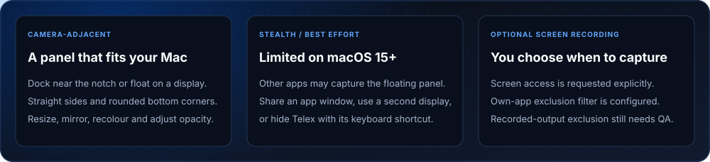
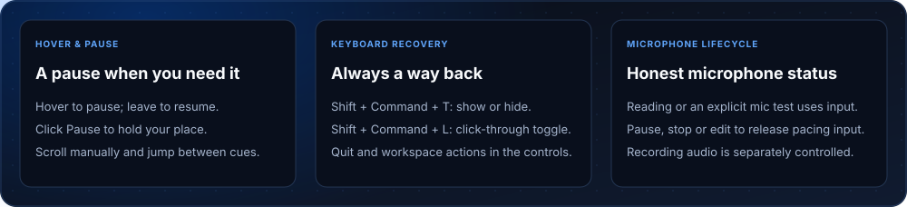
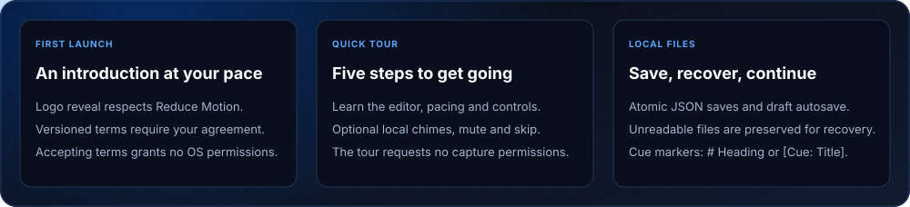
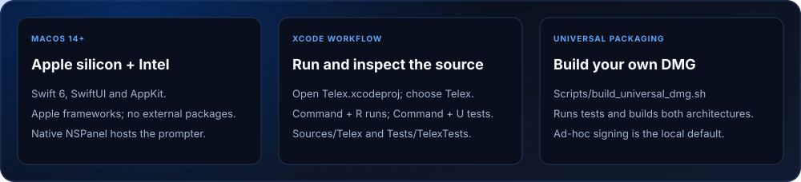
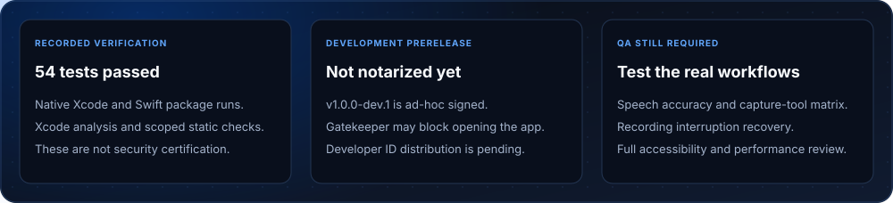

# Telex for macOS



<p align="center">
  <a href="https://telex-website-tau.vercel.app/">Website</a> ·
  <a href="https://github.com/ishuu9837/Telex/releases">Download development build</a> ·
  <a href="https://telex-website-tau.vercel.app/documentation.html">Documentation</a> ·
  <a href="https://telex-website-tau.vercel.app/privacy.html">Privacy</a> ·
  <a href="LICENSE">MIT license</a>
</p>

A native macOS teleprompter built with Swift 6, SwiftUI and AppKit. Keep your script near your camera while another application handles your meeting or video. Telex does not need camera access to display a script. Requires **macOS 14 or later**; the packaging script builds for **Apple silicon and Intel**.

> **Development prerelease:** The current downloadable app is ad-hoc signed, **not Developer ID signed or notarized**. Gatekeeper may block it. See [release notes](RELEASE_NOTES.md) for verification and remaining work.




## Start reading

Download `Telex.dmg` from [GitHub Releases](https://github.com/ishuu9837/Telex/releases), or build from source below. Mount the disk image and drag Telex to Applications. Create or import a script, add `# Heading` or `[Cue: Title]` markers for navigation, then choose **Start reading**.

- **No microphone:** Continuous scrolling without microphone, Speech, camera or screen-recording permission. Six presets: Very slow **40**, Slow **80**, Medium **130**, Medium fast **180**, High **240**, Very high **300 WPM**, plus custom speed.
- **Voice level (default):** Microphone-only pacing responds to speaking and silence. It does not transcribe words or require Siri authorization. Use the labelled **Input level** meter and **Adjust sensitivity from my voice** to calibrate.
- **Script words (optional):** Explicitly enable Apple transcription and choose a supported on-device language. Matching follows your script position; repeated words and off-script speech are handled by the alignment engine. Real-world accuracy still needs validation. When permission, language assets or recognition are unavailable, Telex explains the fallback to voice-level pacing.

Speech permission is requested only through **Enable optional Apple transcription…**. Apple recognition availability depends on system settings and installed language assets; you can leave it disabled.




## Placement, Stealth and recording

Dock near the notch or float the panel on a display. Adjust width, height, font size, text colour, opacity and mirroring. The panel has straight vertical sides, square top corners and rounded bottom corners. Text respects the hardware notch's safe area. A blue-violet glow provides visual feedback; Reduce Motion reduces decorative animation.

**Stealth is best effort.** On **macOS 15 or later**, its status is **Limited**. Third-party full-display sharing may include the prompter. Share an individual application window, use a second display or hide Telex with its shortcut. Telex cannot hide macOS microphone indicators or the system's app-usage attribution. See the [capture verification matrix](STEALTH_VERIFICATION.md).

The optional ScreenCaptureKit recorder has an own-app exclusion filter configured. **Actual recorded-output exclusion and third-party capture behavior remain unverified.** Open **Record**, then explicitly choose **Choose screen or window…** to request screen access. Microphone and system-audio recording default off. Normal teleprompting and Stealth do not require screen access. Built-in camera recording is not implemented.




## Controls and microphone lifecycle

Hover pauses scrolling and reveals controls; moving away resumes unless you clicked Pause to lock it. Scroll manually, jump between cues, change pace, restart, dock or float, open the workspace, hide the panel or quit. A dedicated drag handle moves the floating panel. Controls are configured to accept the first click while another app has focus; broader physical interaction testing remains part of QA.

| Action | Shortcut |
| --- | --- |
| Start reading | ⌘Return |
| Show / hide prompter | ⇧⌘T |
| Toggle click-through | ⇧⌘L |
| Dock / float | ⇧⌘D |
| Next / previous cue | ⌃⌥→ / ⌃⌥← |
| Return to previous cue position | ⌃⌥B |

Click-through shows a visible warning and can be disabled from the menu bar, workspace or shortcut.

Pacing input runs while reading or during an explicit microphone test. Pause, stop, hide or edit to release it. The microphone test also stops when its meter leaves view, the inspector closes or the app deactivates. An explicitly started recording with microphone audio is a separate session. Empty scripts do not start an idle pacing session. No audio is saved by default.




## Onboarding and local data

A brief intro respects Reduce Motion and can be skipped. Versioned terms require your own unchecked-by-default agreement; agreement grants no OS permissions. A repeatable five-step tour has optional local chimes, mute, Back/Next and Skip. The tour never activates capture.

Scripts use versioned ISO-8601 JSON in `~/Library/Application Support/Telex/Scripts/`. Atomic saves flush a temporary file before replacement. Edits autosave after 500 ms and pending drafts flush before quit. Unreadable files are preserved and can be revealed in Finder. Preferences use UserDefaults; recordings use your selected destination.

The native app uses no backend, accounts, analytics or external Swift packages. Script storage and app processing are local. Optional Apple Speech depends on system services and on-device language availability; the app does not offer a network-recognition fallback. Website and release downloads are separate online services.




## Build from source

Use Xcode with the macOS SDK and Swift 6 support. Open [Telex.xcodeproj](Telex.xcodeproj), choose the **Telex** scheme and **My Mac**, then press **⌘R** to run or **⌘U** to test. The native target includes privacy descriptions, icon and entitlements.

```sh
# Alternative Swift Package test workflow
swift test

# Test, build both architectures, verify and package dist/Telex.dmg
./Scripts/build_universal_dmg.sh
```

The default signature is ad hoc for local development. For distribution, provide your own Developer ID certificate and an existing Keychain notarization profile:

```sh
SIGNING_IDENTITY='Developer ID Application: Your Name (TEAMID)' \
NOTARY_PROFILE='your-keychain-profile' ./Scripts/build_universal_dmg.sh
```

No credentials are supplied or stored in the repository. `SKIP_TESTS=1` is available for packaging-only reruns; it does not verify tests.

| Location | Purpose |
| --- | --- |
| [Sources/Telex](Sources/Telex) | Native app, UI, services and domain models |
| [Tests/TelexTests](Tests/TelexTests) | Deterministic unit and integration tests |
| [Package.swift](Package.swift) | Swift Package configuration |
| [Scripts/generate_xcode_project.py](Scripts/generate_xcode_project.py) | Regenerate the native Xcode project |
| [Scripts/generate_readme_assets.py](Scripts/generate_readme_assets.py) | Regenerate all 14 README SVGs without dependencies |
| [Website/telex/dist](Website/telex/dist) | Static product website |




## Verification and remaining work

The development release records **54 passing tests** in native Xcode and Swift Package runs, successful Xcode analysis and **15 scoped static privacy/configuration checks**. The latest recorded test run did not reproduce the fixed geometry-cycling warning. These results are not comprehensive hardware validation or security certification. Live microphone-meter movement has been confirmed.

Remaining QA includes speech-following accuracy, Zoom/Meet/Teams/OBS capture behavior, real recording output and interruption recovery, multi-display/full-screen interactions, complete accessibility and sustained performance. There is no separate Manual mode or built-in camera recorder. Scrolling uses estimated layout metrics; precise measured word-to-layout mapping remains future work.

For release scope and checksum verification, read [RELEASE_NOTES.md](RELEASE_NOTES.md). The source is [MIT licensed](LICENSE). Apple trademarks belong to their respective owners.


